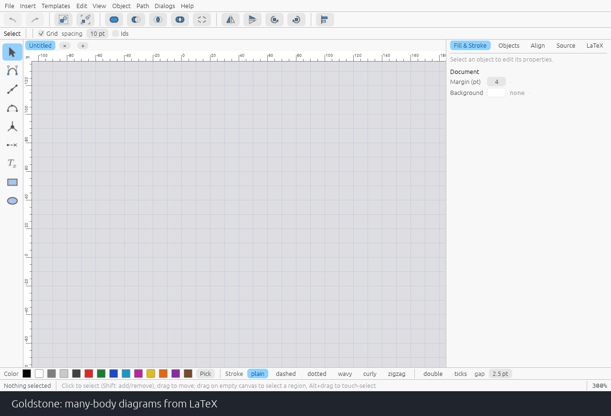
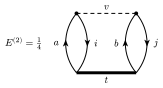
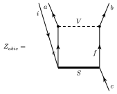
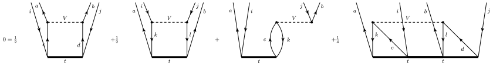
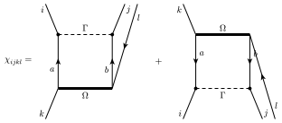
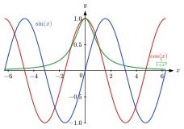
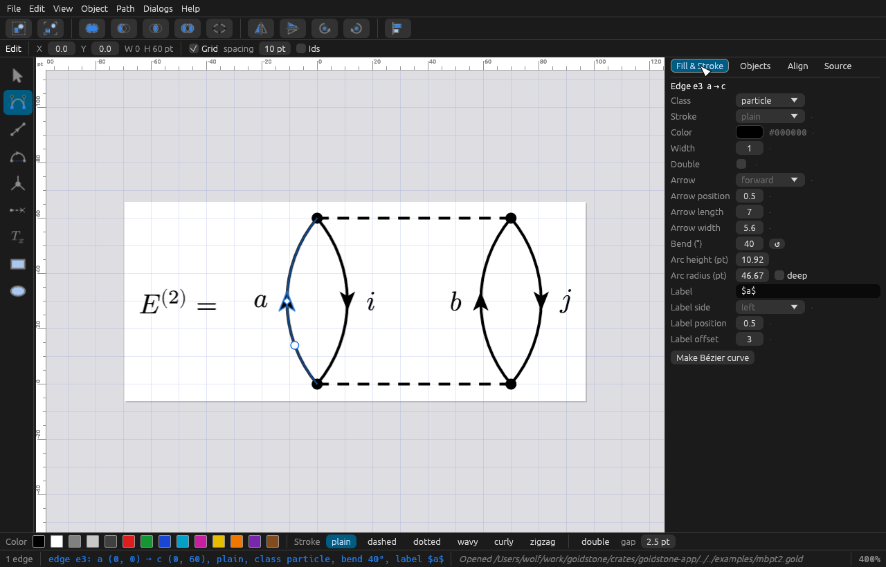
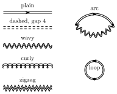
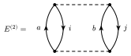

# Goldstone

Draw many-body diagrams — coupled cluster, IMSRG, MBPT; Goldstone and
Hugenholtz style — for papers and talks. Write the equation in LaTeX and
get the diagram, draw by hand in an Inkscape-style editor, or keep
diagrams as plain-text `.gold` files in git.

Renders to **PDF, SVG, PNG and TikZ**. Labels are typeset in Computer
Modern without a TeX installation.



**Download:** [Releases](https://github.com/sunzhg07/goldstone/releases) —
macOS `.dmg`, Windows `.zip`, Linux `.AppImage` / `.deb` / `.tar.gz`.

**In the browser:** [sunzhg07.github.io/goldstone](https://sunzhg07.github.io/goldstone/)
— the same editor, nothing to install (WebAssembly; Chrome, Edge,
Firefox, Safari).

## From LaTeX to diagram

```sh
goldstone cc-latex 'E^{(2)} = \frac{1}{4} \sum_{ijab} V_{ijab} t_{abij}' -o mbpt2.pdf
```



Open diagrams: indices that appear once are external lines.

```sh
goldstone cc-latex 'Z_{abic} = \sum_{ef} V_{abef} S_{efic}' -o open.pdf
```



Sums of terms become rows of diagrams, with prefactors and signs:

```sh
goldstone cc-latex '0 = \frac{1}{2} \sum_{cd} V_{abcd} t_{cdij}
  + \frac{1}{2} \sum_{kl} V_{klij} t_{abkl}
  + P(ij) P(ab) \sum_{kc} V_{kbcj} t_{acik}
  + \frac{1}{4} \sum_{klcd} V_{klcd} t_{cdij} t_{abkl}' -o ccd.pdf
```



`aligned`, `\\` rows and `\left( … \right)` (multiplied out) work; when
there are not enough letters, number the indices (`a_1 a_2 … h_1 h_2 …`):


### IMSRG

`goldstone srg-latex` (Insert ▸ IMSRG Diagram from LaTeX in the editor)
reads every index as a general orbital, letters or digits; occupation
factors decide each line: `n_a` hole, `\bar n_a` or `(1 - n_a)` particle. They are multiplied out
into one diagram per particle–hole assignment; external lines and lines
without a factor have no arrow.

```sh
goldstone srg-latex '\frac{dE}{ds} = \sum_{ab} (n_a - n_b) \eta_{ab} f_{ba}
  + \frac{1}{4} \sum_{abcd} \eta_{abcd} \Gamma_{cdab} n_a n_b \bar{n}_c \bar{n}_d' -o imsrg.pdf
```


```sh
goldstone srg-latex '\chi_{ijkl} = \sum_{ab} \left( \bar{n}_a \bar{n}_b n_l + n_a n_b \bar{n}_l \right) \Gamma_{ijab} \Omega_{abkl}'
```



### The two conventions: CC and IMSRG

Goldstone reads LaTeX with one of two rules: **CC** (`goldstone cc-latex`,
Insert ▸ CC Diagram from LaTeX) and **IMSRG** (`goldstone srg-latex`,
Insert ▸ IMSRG Diagram from LaTeX). The syntax is the same and strict;
only the meaning of the index letters differs.

**Shared syntax**

| Written | Meaning |
|---|---|
| `X^{label}_{pqrs}` | an operator (vertex): ⟨pq\|X\|rs⟩, first half of the indices outgoing (bra), second half incoming (ket); vertex *k* joins the *k*-th outgoing and *k*-th incoming index (p–r, q–s). Braces are required |
| `^{label}` | optional, part of the name, shown as written: `V^{1a}`, `\Gamma^{(2)}`, `\eta^{\rm od}` |
| `V W v w g H F f U \Gamma` | interactions: dashed line (one-body: `---X`); any other name (`T`, `t`, `\tau`, `\eta`, `\Omega`, …) is an amplitude: thick bar |
| `\sum_{…}`, `*`, `\cdot`, `P(ab)`, `(1+P_{12})` | not drawn (summations, products, permutations) |
| `\frac{1}{4}`, `-`, `0.5` | prefactor and sign, written before the diagram |
| `\left( … \right)`, `\begin{aligned} … \\ …` | multiplied out; each `\\` starts a new row of diagrams |
| `Z_{abij} = …` / `0 = …` / no left side | the left side lists the external lines; `0 =` or no left side takes them from what is left open |

**Index letters**

| | CC rule | IMSRG rule |
|---|---|---|
| index forms | `a`, `a_1`, `a_{12}` | `a`, `a_1`, `a_{12}`, and digits `1`…`9` (`f_{12}`, `\Gamma_{1234}`) |
| `a`–`g` (also `a_1`, `b_2`, …) | particle (arrow up) | general orbital (no arrow) |
| `h`–`n` (also `h_1`, `i_2`, …) | hole (arrow down) | general orbital |
| other letters (`p q r s`), digits | general orbital | general orbital |
| `n_a` / `\bar n_a`, `(1-n_a)` | hole / particle (overrides the letter) | hole / particle |
| `(n_a - n_b)`, `(1-n_a-n_b)`, `(n_a n_b \bar n_c + \bar n_a \bar n_b n_c)` | multiplied out: one diagram per particle–hole assignment | same |
| macros | — | `\totd{f_{12}}{s}` (= d f₁₂/ds), `\nn_a` (= \bar n_a) |

The operator's name never changes how its indices are read:
`\Gamma_{ijab}` has the same lines as `V_{ijab}`.

**Layout** (both rules)

- Top to bottom: particle lines run up, hole lines down; that decides
  which operator is above which. General lines do not.
- Left to right: an operator's vertices keep their written order
  (in `V_{ah_1ef}` the vertex a–e is left of h₁–f), and a line continues
  in the column of the line it joins, so the written order fixes the
  picture.

```sh
goldstone cc-latex '\sum_{efh_1h_2} V_{ah_1ef} V_{efch_2} Z_{h_2bh_1d}'   # numbered holes
goldstone cc-latex '\sum_{ph} \Gamma^{II}_{ahcp} T_{pbhd}'                # p is a general line
goldstone srg-latex '\totd{f_{12}}{s} = \sum_{a}(1+P_{12})\eta_{1a}f_{a2} + \sum_{ab}(n_a-n_b)(\eta_{ab}\Gamma_{b1a2}-f_{ab}\eta_{b1a2})'
```

**Rejected**, with a message that says what to write:

| Written | Why |
|---|---|
| `V_ijab`, `t_i^a`, `T{aj}` | braces are required: `V_{ijab}` |
| `t^{ab}_{ij}` | the superscript is a label; all indices go in the subscript: `t_{abij}` |
| `\langle ij \|\| ab \rangle` | write the operator: `V_{ijab}` |
| `a1`, `a'`, capitals; digits in CC | an index is `a` or `a_1` (IMSRG: or a digit) |
| `sum_{ab}`, `frac{1}{2}` | commands need their backslash |
| `\Gamma_{diej}` where *d* is outgoing on another operator too | the term relies on hermiticity (Γ<sub>pqrs</sub> = Γ<sub>rspq</sub>); Goldstone does not use it: write `\Gamma_{ejdi}` |
| commutators, normal-ordered operator strings, operators in a denominator | not diagrams |

### Function plots

```sh
goldstone plot 'sin(x); cos(x); \frac{1}{1+x^2}' --x=-2pi:2pi -o plot.pdf
```



Plain (`exp(-x^2/2)`) or LaTeX (`e^{-x^2/2}`) notation. In the editor:
Insert ▸ Function Plot…; the plot is editable objects.

### Edit the equation, the drawing follows

A diagram from LaTeX or a plot remembers its source: select it and edit
the equation in the **LaTeX** tab of the right panel; it is redrawn as you
type.

### Templates

A built-in library: basic shapes, block arrows, stars, flowchart symbols,
callouts, equation shapes, many-body (MBPT, CC, IMSRG) and Feynman
diagrams; save your own from the selection. Templates ▸ … in the editor,
or `goldstone templates -o sheet.pdf` for an overview.

### A whole document

```sh
goldstone paper.tex            # or: goldstone tex paper.tex -f png --out-dir figs (--srg: IMSRG rule)
```

finds every equation (`equation`, `align`, `eqnarray`, `\[ \]`, …) and
writes `paper-diagrams/`: one file per equation (`eq0003-L37.pdf` =
equation 3, line 37), overview pages for checking, `all.gold` with every
diagram (open it in the editor), and `report.txt` with what could not be
drawn and why. A file of 539 CCSDT terms takes about two seconds.

## The editor

```sh
goldstone                      # or: goldstone fig.gold
```



Interface in English or 简体中文 (View ▸ Language). Tabs for several diagrams, right-click menus everywhere, resize handles, a screen color picker, Help ▸ Check for Updates. Inkscape layout and shortcuts (⌘ on macOS, Ctrl elsewhere): Line, Arc,
Vertex, Cross (`---X`), Text, Rectangle and Ellipse tools; snapping;
rubber-band, Shift and Alt (touch) selection; editing many objects at
once; groups, copy/paste (as `.gold` text), align and distribute, boolean
operations on shapes; rulers and object ids with coordinates. **Insert ▸
CC / IMSRG Diagram from LaTeX** (⌘⇧T) inserts a diagram from an equation:


Every line style works on straight lines, arcs, Bézier curves and loops,
including double lines and lines with ticks or marks:

<p>



</p>

## Diagrams as text

```toml
format = 1

[style.particle]
arrow = "forward"

[style.hole]
arrow = "backward"

[style.interaction]
stroke = "dashed"

[[vertex]]
id = "a"
at = [0, 0]
kind = "dot"

[[vertex]]
id = "c"
at = [0, 60]
kind = "dot"

[[edge]]
from = "a"
to = "c"
class = "particle"
bend = 40
label = "$a$"

# … see examples/mbpt2.gold
```



Coordinates are in TeX points, y up. Lines refer to vertices by name, so
moving a vertex moves its lines. Saving from the editor keeps your
comments and layout.

## Command line

```sh
goldstone render fig.gold                    # → fig.pdf
goldstone render fig.gold -o fig.svg         # format from the extension
goldstone render figs/*.gold -f tikz --out-dir paper/figs
goldstone render fig.gold -o slide.png --background white --dpi 600
goldstone cc-latex '…' -o eq.pdf             # CC diagram of an equation
goldstone srg-latex '…' -o eq.pdf            # IMSRG diagram of an equation
goldstone plot 'sin(x)' --x=-pi:pi -o f.pdf  # function plot
goldstone templates -o sheet.pdf             # all built-in templates
goldstone paper.tex                          # every equation of a document
goldstone ls fig.gold                        # objects with ids and coordinates
goldstone check figs/*.gold                  # validate, typeset all labels
goldstone extract fig.svg > fig.gold         # SVGs carry their .gold source
goldstone keys                               # keyboard and mouse reference
```

| Extension | What you get |
|---|---|
| `.pdf` | vector PDF cropped to the drawing |
| `.svg` | vector SVG with the `.gold` source embedded (reopen it in Goldstone) |
| `.png` | raster image (`--dpi`, default 300) |
| `.tikz` | a bare `tikzpicture` to `\input` into a paper; labels use your document's fonts |
| `.tex` | a complete LaTeX document cropped to the picture |

## Documentation

- [User manual](docs/MANUAL.md): editor, keys (Linux/Windows and macOS), file format by example
- [Design](docs/DESIGN.md): file format reference, architecture
- [LaTeX parser plan](docs/PARSER_PLAN.md): what notation is covered, test corpus, layout quality

## Build from source

```sh
cargo build --release          # binary: target/release/goldstone
cargo test --workspace
```

The web version: `cd crates/goldstone-web && trunk serve` (needs
`rustup target add wasm32-unknown-unknown` and
[trunk](https://trunkrs.dev)); GitHub Actions publishes it to GitHub Pages
on every push to `main`.

Release packages are built by GitHub Actions
([`.github/workflows/release.yml`](.github/workflows/release.yml)) when a
`v*` tag is pushed.

## License

Goldstone is MIT-licensed. The program includes third-party crates and
fonts (New Computer Modern, Libertinus, DejaVu for labels; Ubuntu, Hack,
Noto Emoji for the editor) under their own permissive licenses, listed
with their notices in [THIRD_PARTY_LICENSES.md](THIRD_PARTY_LICENSES.md),
in every release package, by `goldstone licenses`, and in Help ▸ About.
Regenerate the file after changing dependencies:
`python3 packaging/third_party_licenses.py -o THIRD_PARTY_LICENSES.md`.
