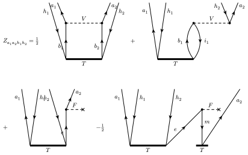
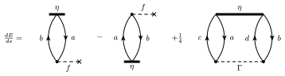
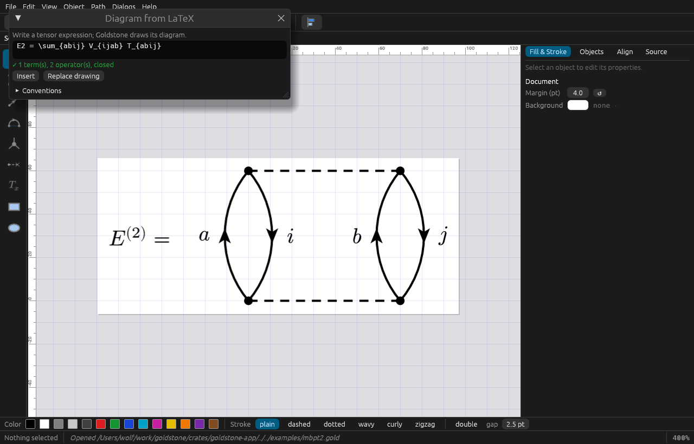
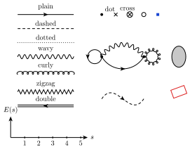
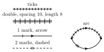

# Goldstone

Draw many-body diagrams — coupled cluster, IMSRG, MBPT; Goldstone and
Hugenholtz style — for papers and talks. Write the equation in LaTeX and
get the diagram, draw by hand in an Inkscape-style editor, or keep
diagrams as plain-text `.gold` files in git.

Renders to **PDF, SVG, PNG and TikZ**. Labels are typeset in Computer
Modern without a TeX installation.

**Download:** [Releases](https://github.com/sunzhg07/goldstone/releases) —
macOS `.dmg`, Windows `.zip`, Linux `.AppImage` / `.deb` / `.tar.gz`.

**In the browser:** [sunzhg07.github.io/goldstone](https://sunzhg07.github.io/goldstone/)
— the same editor, nothing to install (WebAssembly; Chrome, Edge,
Firefox, Safari).

## From LaTeX to diagram

```sh
goldstone latex 'E^{(2)} = \frac{1}{4} \sum_{ijab} \langle ij || ab \rangle t_{ij}^{ab}' -o mbpt2.pdf
```


Open diagrams: indices that appear once are external lines.

```sh
goldstone latex 'Z_{abic} = \sum_{ef} V_{abef} S_{efic}' -o open.pdf
```


Sums of terms become rows of diagrams, with prefactors and signs:

```sh
goldstone latex '0 = \frac{1}{2} \sum_{cd} \langle ab||cd \rangle t_{ij}^{cd}
  + \frac{1}{2} \sum_{kl} \langle kl||ij \rangle t_{kl}^{ab}
  + P(ij) P(ab) \sum_{kc} \langle kb||cj \rangle t_{ik}^{ac}
  + \frac{1}{4} \sum_{klcd} \langle kl||cd \rangle t_{ij}^{cd} t_{kl}^{ab}' -o ccd.pdf
```


Equations as printed in papers work as they are — `aligned`, `\\` rows,
`\left( … \right)` multiplied out, `\mathcal{F}`, `\mathcal{W}`, `\tau`,
`P(ij)` (left out), and either index convention (`t_{ij}^{ab}` or
`\mathcal{W}_{mn}^{ij}`). The CCSD doubles equation of Stanton and Gauss:



### IMSRG and VS-IMSRG

Indices are general orbitals; occupation factors decide each line:
`n_a` hole, `\bar n_a` or `(1 - n_a)` particle. They are multiplied out
into one diagram per particle–hole assignment; external lines and lines
without a factor have no arrow.

```sh
goldstone latex '\frac{dE}{ds} = \sum_{ab} (n_a - n_b) \eta_{ab} f_{ba}
  + \frac{1}{4} \sum_{abcd} \eta_{abcd} \Gamma_{cdab} n_a n_b \bar{n}_c \bar{n}_d' -o imsrg.pdf
```



```sh
goldstone latex '\chi_{ijkl} = \sum_{ab} \left( \bar{n}_a \bar{n}_b n_l + n_a n_b \bar{n}_l \right) \Gamma_{ijab} \Omega_{abkl}'
```


### Conventions

| Notation | Meaning |
|---|---|
| `X_{pqrs}` | ⟨pq\|X\|rs⟩: first half outgoing (bra), second half incoming (ket); `X^{pq}_{rs}` the same |
| `a`–`h` / `i`–`n` | particles (arrow up) / holes (arrow down) in CC notation |
| `V W v w g H F f U` | interactions: dashed line, one-body `---X` |
| other names (`t`, `T`, `\tau`, `S`, …) | amplitudes: thick bar |
| `\hat J`, `(-1)^{…}`, 6j symbols, `\delta`, `^{J}` | not part of the diagram, left out |
| `T{aj}` and other non-LaTeX | an error that says what to write |

### Function plots

```sh
goldstone plot 'sin(x); cos(x); \frac{1}{1+x^2}' --x=-2pi:2pi -o plot.pdf
```


Plain (`exp(-x^2/2)`) or LaTeX (`e^{-x^2/2}`) notation. In the editor:
Insert ▸ Function Plot…; the plot is editable objects.

### Edit the equation, the drawing follows

A diagram from LaTeX or a plot remembers its source: select it and edit
the equation in the **LaTeX** tab of the right panel; it is redrawn as you
type.

### Templates

A built-in library: basic shapes, block arrows, stars, flowchart symbols,
callouts, equation shapes, many-body (MBPT, CC, IMSRG) and Feynman
diagrams; save your own from the selection. Templates ▸ … in the editor,
or `goldstone templates -o sheet.pdf` for an overview.

### A whole document

```sh
goldstone paper.tex            # or: goldstone tex paper.tex -f png --out-dir figs
```

finds every equation (`equation`, `align`, `eqnarray`, `\[ \]`, …) and
writes `paper-diagrams/`: one file per equation (`eq0003-L37.pdf` =
equation 3, line 37), overview pages for checking, `all.gold` with every
diagram (open it in the editor), and `report.txt` with what could not be
drawn and why. A file of 539 CCSDT terms takes about two seconds.

## The editor

```sh
goldstone                      # or: goldstone fig.gold
```


Interface in English or 简体中文 (View ▸ Language). Tabs for several diagrams, right-click menus everywhere, resize handles, a screen color picker, Help ▸ Check for Updates. Inkscape layout and shortcuts (⌘ on macOS, Ctrl elsewhere): Line, Arc,
Vertex, Cross (`---X`), Text, Rectangle and Ellipse tools; snapping;
rubber-band, Shift and Alt (touch) selection; editing many objects at
once; groups, copy/paste (as `.gold` text), align and distribute, boolean
operations on shapes; rulers and object ids with coordinates. **File ▸
Diagram from LaTeX** (⌘⇧T) inserts a diagram from an equation:



Every line style works on straight lines, arcs, Bézier curves and loops,
including double lines and lines with ticks or marks:

<p>



</p>

## Diagrams as text

```toml
format = 1

[style.particle]
arrow = "forward"

[style.hole]
arrow = "backward"

[style.interaction]
stroke = "dashed"

[[vertex]]
id = "a"
at = [0, 0]
kind = "dot"

[[vertex]]
id = "c"
at = [0, 60]
kind = "dot"

[[edge]]
from = "a"
to = "c"
class = "particle"
bend = 40
label = "$a$"

# … see examples/mbpt2.gold
```


Coordinates are in TeX points, y up. Lines refer to vertices by name, so
moving a vertex moves its lines. Saving from the editor keeps your
comments and layout.

## Command line

```sh
goldstone render fig.gold                    # → fig.pdf
goldstone render fig.gold -o fig.svg         # format from the extension
goldstone render figs/*.gold -f tikz --out-dir paper/figs
goldstone render fig.gold -o slide.png --background white --dpi 600
goldstone latex '…' -o eq.pdf                # diagram of an equation
goldstone plot 'sin(x)' --x=-pi:pi -o f.pdf  # function plot
goldstone templates -o sheet.pdf             # all built-in templates
goldstone paper.tex                          # every equation of a document
goldstone ls fig.gold                        # objects with ids and coordinates
goldstone check figs/*.gold                  # validate, typeset all labels
goldstone extract fig.svg > fig.gold         # SVGs carry their .gold source
goldstone keys                               # keyboard and mouse reference
```

| Extension | What you get |
|---|---|
| `.pdf` | vector PDF cropped to the drawing |
| `.svg` | vector SVG with the `.gold` source embedded (reopen it in Goldstone) |
| `.png` | raster image (`--dpi`, default 300) |
| `.tikz` | a bare `tikzpicture` to `\input` into a paper; labels use your document's fonts |
| `.tex` | a complete LaTeX document cropped to the picture |

## Documentation

- [User manual](docs/MANUAL.md): editor, keys (Linux/Windows and macOS), file format by example
- [Design](docs/DESIGN.md): file format reference, architecture
- [LaTeX parser plan](docs/PARSER_PLAN.md): what notation is covered, test corpus, layout quality

## Build from source

```sh
cargo build --release          # binary: target/release/goldstone
cargo test --workspace
```

The web version: `cd crates/goldstone-web && trunk serve` (needs
`rustup target add wasm32-unknown-unknown` and
[trunk](https://trunkrs.dev)); GitHub Actions publishes it to GitHub Pages
on every push to `main`.

Release packages are built by GitHub Actions
([`.github/workflows/release.yml`](.github/workflows/release.yml)) when a
`v*` tag is pushed.

## License

Goldstone is MIT-licensed. The program includes third-party crates and
fonts (New Computer Modern, Libertinus, DejaVu for labels; Ubuntu, Hack,
Noto Emoji for the editor) under their own permissive licenses, listed
with their notices in [THIRD_PARTY_LICENSES.md](THIRD_PARTY_LICENSES.md),
in every release package, by `goldstone licenses`, and in Help ▸ About.
Regenerate the file after changing dependencies:
`python3 packaging/third_party_licenses.py -o THIRD_PARTY_LICENSES.md`.
